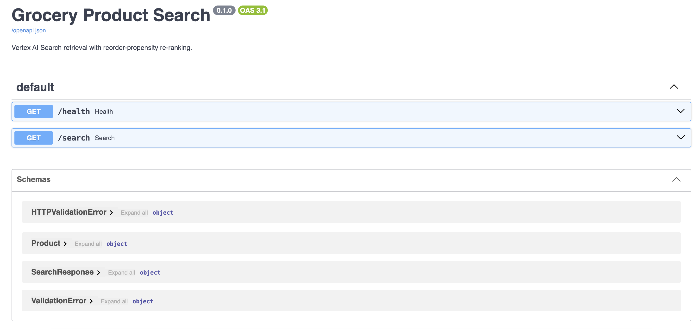
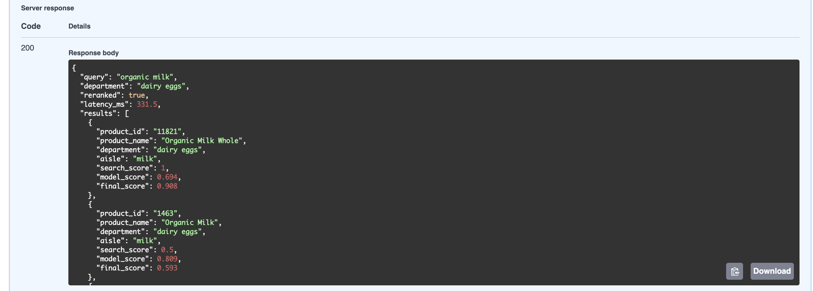
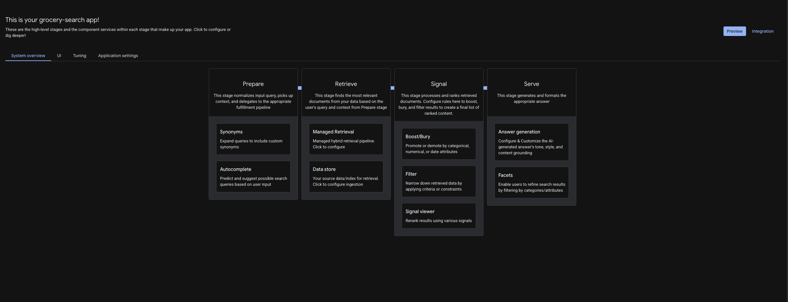
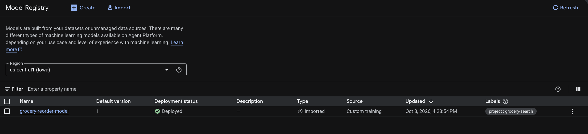
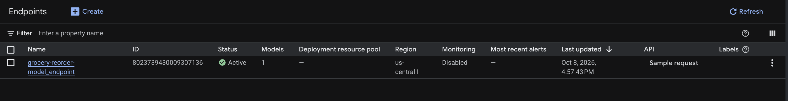
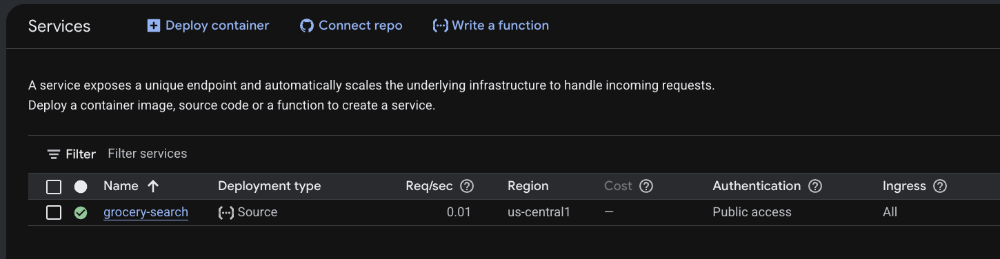

# Grocery Product Search & Re-ranking on Google Cloud

[](https://github.com/priyankabolem/grocery-search-vertex/actions/workflows/ci.yml)

A two-stage product search service for a grocery catalog. **Vertex AI Search** retrieves candidate
products for a text query, a **gradient boosting model served from a Vertex AI endpoint** re-ranks
them by predicted reorder propensity, and a **FastAPI** service on **Cloud Run** blends both signals
into the final ranking.

**Stack:** Python · BigQuery · Cloud Storage · Vertex AI Search · Vertex AI Model Registry & Endpoints ·
scikit-learn · FastAPI · Docker · Cloud Run · GitHub Actions

## Architecture

```
OFFLINE
  Instacart CSVs ─► 01_prepare_data.py ─► catalog.csv ─► Cloud Storage ─► BigQuery (grocery.products)
                                                                              │
                                                     Vertex AI Search data store + search app
  catalog.csv ─► 03_train_and_deploy.py ─► model.joblib ─► Model Registry ─► Vertex AI Endpoint

ONLINE   GET /search?q=organic milk&department=dairy eggs
  FastAPI on Cloud Run
    1. Vertex AI Search    → top-k candidate products (optional department filter)
    2. Vertex AI Endpoint  → reorder-propensity score per candidate (single batched call)
    3. final_score = 0.7 × search_score + 0.3 × model_score → ranked JSON response
```

## Data

[Instacart Market Basket Analysis](https://www.kaggle.com/datasets/psparks/instacart-market-basket-analysis) (Kaggle, CC0).
Place `products.csv`, `aisles.csv`, `departments.csv` and `order_products__train.csv` in `data/`.

The catalog has one row per product with behavioral features:

| Column | Meaning |
|---|---|
| `order_count` | Number of orders containing the product (popularity) |
| `reorder_rate` | Share of those orders that were reorders — **model target** |
| `avg_cart_position` | Average add-to-cart position (habitual items are added early) |
| `aisle`, `department` | Category names; `department` is a search filter |

Products with fewer than 20 orders are excluded so the statistics are reliable.

## Ranking

| Signal | Source | Definition |
|---|---|---|
| `search_score` | Vertex AI Search | Reciprocal rank: 1.0, 0.5, 0.33, … |
| `model_score` | Vertex AI endpoint | Predicted reorder propensity |
| `final_score` | API | `0.7 × search_score + 0.3 × model_score` (weights configurable) |

Example: retrieval order A, B, C with model scores 0.40, 0.85, 0.60 → final scores 0.82, 0.61, 0.41.
Scores are rounded to three decimals in the response; ordering uses the unrounded values.
Relevance dominates, and the model lifts frequently re-bought items when relevance is close.

**Graceful degradation:** if no endpoint is configured or a prediction call fails, the API logs the
error and returns results in retrieval order (`"reranked": false`) instead of failing the request.

## Project structure

```
grocery_search/
  config.py        settings from environment variables, feature list
  features.py      catalog + feature engineering (pure pandas, unit tested)
  ranking.py       score blending and re-ranking (no cloud dependencies, unit tested)
  api.py           FastAPI app: /health, /search, OpenAPI docs at /docs
scripts/
  01_prepare_data.py     build data/catalog.csv
  02_load_to_gcp.py      upload to Cloud Storage, load BigQuery with an explicit schema
  03_train_and_deploy.py train + evaluate, register in Model Registry, deploy endpoint
  04_cleanup.py          undeploy and delete the endpoint
tests/                   pytest unit tests for features and ranking
docs/images/             screenshots of the running system
.github/workflows/ci.yml lint + tests on every push
Dockerfile               non-root image for Cloud Run (also runs on GKE)
Makefile                 shortcuts for every step
```

## Setup

Requires Python 3.11 or 3.12, the [gcloud CLI](https://cloud.google.com/sdk/docs/install), and a
Google Cloud project with billing enabled.

```bash
# Python environment
python3.11 -m venv .venv && source .venv/bin/activate
make install                       # dependencies + editable install of grocery_search
make test                          # unit tests run locally, no cloud access needed

# Google Cloud
gcloud auth login
gcloud auth application-default login
gcloud config set project YOUR_PROJECT_ID
gcloud services enable aiplatform.googleapis.com discoveryengine.googleapis.com \
  bigquery.googleapis.com storage.googleapis.com run.googleapis.com \
  cloudbuild.googleapis.com artifactregistry.googleapis.com
gcloud storage buckets create gs://YOUR_BUCKET --location=us-central1

# Configuration
cp .env.example .env               # set PROJECT_ID and BUCKET
set -a; source .env; set +a
```

## Run

| Step | Command | Result |
|---|---|---|
| 1. Build catalog | `make prepare` | `data/catalog.csv` |
| 2. Load to GCP | `make load` | BigQuery table `grocery.products` |
| 3. Search app | Console (below) | `SEARCH_ENGINE_ID` |
| 4. Train + deploy | `make train` | `artifacts/metrics.json`, `ENDPOINT_ID` |
| 5. Serve locally | `make serve` | http://127.0.0.1:8000/docs |
| 6. Deploy | `make deploy` | Public Cloud Run URL |
| 7. Clean up | `make cleanup` | Endpoint deleted (stops hourly billing) |

**Step 3 – Vertex AI Search (console):** AI Applications → **Create app** → **Search** (location
`global`) → create a data store from **BigQuery**, table `grocery.products`, **structured data**.
The console may generate its own document IDs rather than using a column; that is fine, because the
API reads `product_id` from each document's data, not from its document ID. In the schema, mark
`product_name` searchable and `department` filterable.
Wait for indexing to finish, then copy the app ID into `SEARCH_ENGINE_ID` in `.env`.

**Step 4 options:** `python scripts/03_train_and_deploy.py --skip-deploy` trains and evaluates
locally (reports MAE against a mean-prediction baseline and R²) without creating cloud resources.

**Step 6 permissions:** two different service accounts are involved.

The Cloud Run *runtime* service account calls the two backends, so it needs `roles/aiplatform.user`
and `roles/discoveryengine.user`.

Deploying from source also builds the image, and the build runs as the Compute Engine default
service account. New projects no longer grant that account any roles by default, so a source deploy
fails while reading its own uploaded source unless it has:

| Role | Needed for |
|---|---|
| `roles/storage.objectViewer` | Reading the uploaded source archive |
| `roles/artifactregistry.writer` | Pushing the built image |
| `roles/logging.logWriter` | Writing build logs |

```bash
SA="$(gcloud projects describe $PROJECT_ID --format='value(projectNumber)')-compute@developer.gserviceaccount.com"
for ROLE in roles/aiplatform.user roles/discoveryengine.user \
            roles/storage.objectViewer roles/artifactregistry.writer roles/logging.logWriter; do
  gcloud projects add-iam-policy-binding "$PROJECT_ID" \
    --member="serviceAccount:$SA" --role="$ROLE" --condition=None
done
```

### Example response

```bash
curl "http://127.0.0.1:8000/search?q=organic%20milk&department=dairy%20eggs&k=3"
```

```json
{
  "query": "organic milk",
  "department": "dairy eggs",
  "reranked": true,
  "latency_ms": 374.8,
  "results": [
    {
      "product_id": "11821",
      "product_name": "Organic Milk Whole",
      "department": "dairy eggs",
      "aisle": "milk",
      "search_score": 1.0,
      "model_score": 0.694,
      "final_score": 0.908
    },
    {
      "product_id": "1463",
      "product_name": "Organic Milk",
      "department": "dairy eggs",
      "aisle": "milk",
      "search_score": 0.5,
      "model_score": 0.809,
      "final_score": 0.593
    },
    {
      "product_id": "27845",
      "product_name": "Organic Whole Milk",
      "department": "dairy eggs",
      "aisle": "milk",
      "search_score": 0.333,
      "model_score": 0.841,
      "final_score": 0.486
    }
  ]
}
```

## Results

Measured on the filtered catalog of 9,162 products, built from the Instacart dataset by keeping only
products with at least 20 orders, with the service running against a Vertex AI Search app in
`global` and a `n1-standard-2` Vertex AI endpoint in `us-central1`.

| | |
|---|---|
| Catalog | 9,162 products, 21 departments, 133 aisles |
| Search index | 9,162 documents |
| Train / test split | 7,329 / 1,833 products |
| Test MAE | **0.0930**, against **0.1279** for a mean-prediction baseline (27% lower) |
| Test R² | 0.4552 |
| `/search` latency, Cloud Run | 123 ms median, 152 ms p95 |
| `/search` latency, local | 209 ms median, 406 ms p95 |

Each latency figure is 20 warm requests at `k=10`, spread across ten queries, covering both stages:
retrieval plus one batched prediction call. Cold starts are excluded. The deployed service is
faster than a local one because it shares a region with the endpoint, while a laptop adds a round
trip to both backends.

Reorder rate is bounded in `[0, 1]`, so the absolute errors are small by construction and the
comparison against the baseline is the meaningful number.

## Screenshots


*OpenAPI docs served at `/docs`, exposing `/health` and `/search` with the response schemas.*


*A `/search` call for "organic milk" filtered to `dairy eggs`, with all three scores per product.*


*The search app in AI Applications; the Retrieve stage is backed by the BigQuery data store.*


*`grocery-reorder-model` version 1 registered in `us-central1` and marked deployed.*


*The endpoint serving the model, active with one model in `us-central1`.*


*The `grocery-search` service deployed from source in `us-central1` with public access.*

## Design decisions

- **Retrieve, then re-rank.** Retrieval is cheap and recall-oriented across the whole catalog; the
  model runs only on the top-k candidates, in one batched prediction call.
- **Explicit BigQuery schema.** Vertex AI Search requires a STRING document ID, which schema
  autodetection would infer as INTEGER.
- **Pinned scikit-learn 1.3.x** to match Vertex AI's prebuilt `sklearn-cpu.1-3` serving container.
- **Cloud-free core logic.** Feature engineering and ranking are pure functions, so they are unit
  tested in CI without credentials.
- **Cloud Run** for low idle cost (scales to zero); the same image runs on GKE.

## Limitations and next steps

- The model scores products, not users or queries. Next: learning-to-rank on query–click/purchase
  data with user features, and personalization through Vertex AI Search for commerce user events.
- Blend weights are hand-set. Tune them against offline NDCG@k / MRR and validate with an online A/B test.
- Latency: cache popular queries, precompute product-level scores in BigQuery, keep warm replicas.
- Monitoring: Cloud Monitoring alerts on p95/p99 latency and error rate; Vertex AI Model Monitoring for drift.

## License

MIT
